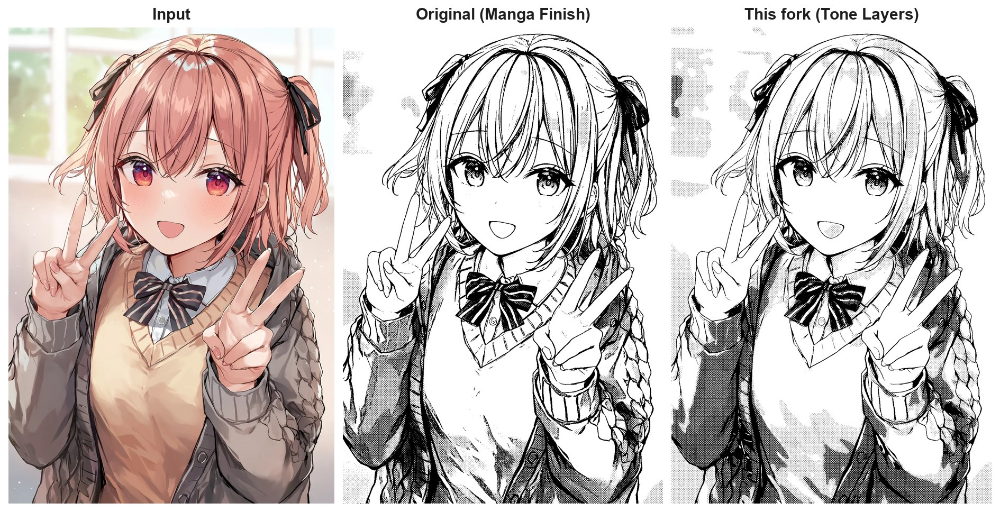
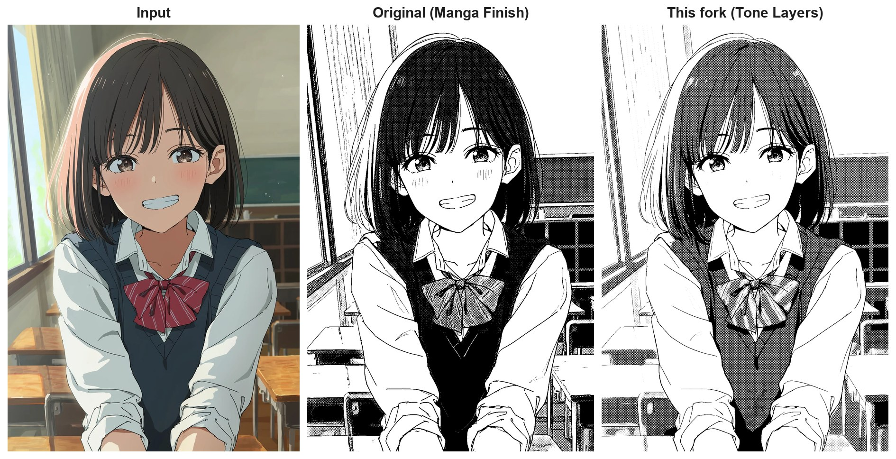
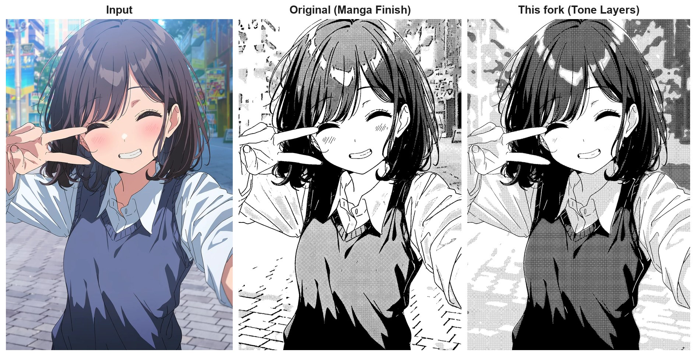
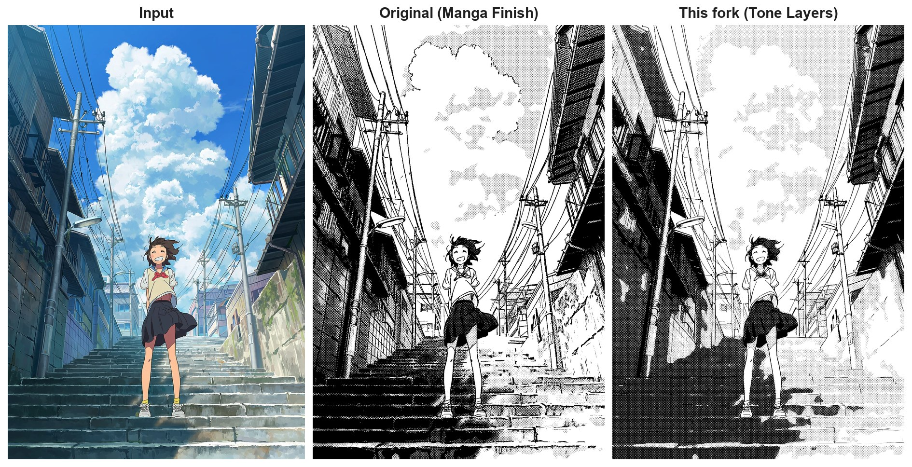
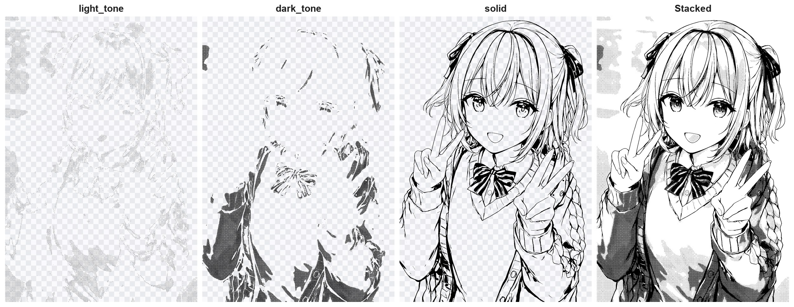
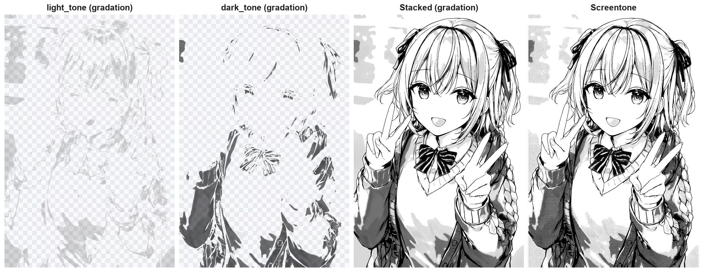

# ComfyUI-MangaScreen — Tone Layers fork

> This is a fork of [ashukae/ComfyUI-MangaScreen](https://github.com/ashukae/ComfyUI-MangaScreen).
> The original nodes (Manga Finish / Manga Levels / Manga Panel) and workflows are unchanged; this fork adds
> three nodes and a workflow that turn the result into **separate, editable layers**.
> The fork additions are described first ([English](#fork-additions) · [日本語](#フォークでの追加変更点)), followed by the original README.

## Fork additions

- **Clean up the lines and blacks after the first pass, then fill the gaps with tone** — the solid layer (line art + blacks) from the first pass is redrawn by Qwen-Image as clean ink. Whatever was black before and is no longer black after the redraw is handed back to the tone layers, continued from the surrounding gradation, so no hole is left.
- **Layered output** — light tone, dark tone and solid (line art + blacks) come out as three transparent PNGs that never overlap.
- **Gradation output for the tone areas** — the tone layers can be output as smooth density masks instead of dots, to retouch in Clip Studio Paint or similar and put your own screentone on. Screentone (dots) output is also available.
- **Tone levels set automatically from the source image** — `level_mode: auto` picks the white point / black point (paper, light tone, dark tone, black) from the image itself with a multi-Otsu split.

### Comparison with the original

Same Qwen-Image redraw (fixed seed) for both. *Original* is the Manga Finish node with the settings of the QWEN-Manga workflow; *This fork* is the QWEN-Manga-ToneLayers workflow with its default settings (layers stacked onto white).






Layered output (transparent areas shown as a checkerboard):



Gradation output vs screentone output:



### Nodes

**Manga Finish Layers (Tone / Solid RGBA)** — Manga Finish split into layers. Outputs `light_tone`, `dark_tone`, `solid` (RGBA) and the `white_point` / `black_point` actually used. Inputs not in Manga Finish:

| Input | Default | |
|---|---|---|
| level_mode | auto | `auto`: white / black point from the image (multi-Otsu; the two widgets are greyed out). `manual`: use `white_point` / `black_point` |
| tone_split | 0 | Density where gradation moves from the light to the dark layer. 0 = midway between the two tones |
| tone_output | gradation (smooth) | Smooth density masks, or screentone dots |
| mask_scale | density | Smooth mode: alpha = real tone density, or stretched so each layer's tone is alpha 1 |
| lines_in_solid | true | Put the pen lines into the solid layer (off: filled blacks only) |
| ink_color | #000000 | Ink colour of all layers |
| line_cleanup | 0.4 | Stroke detection that ignores grain and the rims of highlights (no ragged fuzz around hair lines). 0 = as Manga Finish |
| tone_flatten | 0 | 1 = no gradation, every tone flat |
| line_antialias | 0 | Antialiasing of the solid layer; the tone runs under the soft edge, so there is no white fringe |

**Manga Solid Refine (Tone Fill)** — takes the three layers and `refined` (the solid layer redrawn by an edit model, black on white) and returns the final three layers.

| Input | Default | |
|---|---|---|
| threshold / edge_softness / despeckle | 0.5 / 0.2 / 12 | How the redraw becomes the new solid layer: black cut-off, edge softness, removal of small specks and pinholes |
| tone_fill | 1.0 | How strongly lost blacks are filled with the surrounding gradation. 0 = leave them white |
| fill_floor | 1.0 | Minimum density for a vanished black mass, even on white surroundings |
| tone_flatten | 0.7 | Pull the tones toward each layer's flat level. 1 = completely flat |
| line_antialias | 0.5 | Antialiasing of the final solid layer |
| tone_output / screen_lines | screentone (dots) / 250 | Screentone dots (one 45° screen for both layers, no moiré) or smooth gradation |

**Manga Layer Flatten** — stacks RGBA layers onto paper as an RGB image (to feed the solid layer to Qwen, or to preview the page).

### Workflow

**QWEN-Manga-ToneLayers** (`workflows/QWEN-Manga-ToneLayers.json`) — the details are grouped into subgraphs; on the canvas you only see the input image, Manga Finish Layers, Manga Solid Refine and the outputs.

1. *Stage 1: Qwen Manga Redraw* — the same redraw as QWEN-Manga, plus the pen lines → **Manga Finish Layers**
2. *Stage 2: Qwen Solid Cleanup* — Qwen redraws the solid layer as clean line art and blacks → **Manga Solid Refine** → light tone / dark tone / solid previews (right-click → Save Image for transparent PNGs)

The edit instructions (`edit_instruction`, `cleanup_instruction`) and the stage 2 seed can be edited on the subgraph nodes. Models and requirements are the same as the QWEN-Manga workflow below.

### Install

```
cd ComfyUI/custom_nodes
git clone https://github.com/hirazisora/ComfyUI-MangaScreen
```

Use either this fork or the original, not both: they register the same node names.

## フォークでの追加・変更点

- **一次処理後に線画・ベタをブラッシュアップし、トーンで補間** — 一次処理で作った solid（線画＋ベタ）を Qwen-Image できれいな線画とベタに描き直します。描き直しで黒でなくなった部分は、周囲のグラデーションから続けてトーンレイヤーに補間するので、穴が空きません。
- **レイヤー分け出力** — 薄いトーン・濃いトーン・solid（線画＋ベタ）を、互いに重ならない3枚の透過 PNG で出力します。
- **トーン領域のグラデーション出力** — トーンを網点ではなく滑らかな濃淡マスクで出力できます。Clip Studio Paint などで修正し、好きなスクリーントーンを貼る使い方を想定しています。網点での出力もできます。
- **元画像からトーン化の基準値を自動設定** — `level_mode: auto` で、紙・薄いトーン・濃いトーン・ベタを分ける white_point / black_point を、画像の明るさの分布から multi-Otsu 法で自動で決めます。

### オリジナル版との比較

段階1の Qwen-Image による描き直しは両方で同じもの（シード固定）を使っています。*Original* は QWEN-Manga ワークフローの設定の Manga Finish ノード、*This fork* は QWEN-Manga-ToneLayers ワークフローの既定設定です（3レイヤーを白地に重ねたもの）。比較画像・レイヤー出力・グラデーション出力の図は英語セクションにあります。

### ノード

- **Manga Finish Layers (Tone / Solid RGBA)** — Manga Finish をレイヤーに分けたもの。`light_tone` / `dark_tone` / `solid`（RGBA）と、実際に使われた `white_point` / `black_point` を出力します。追加の入力は `level_mode`（auto / manual）、`tone_split`、`tone_output`（グラデーション / 網点）、`mask_scale`、`lines_in_solid`、`ink_color`、`line_cleanup`（髪などの線の周りのガビガビを防ぐ）、`tone_flatten`（トーンの単調化）、`line_antialias` です。
- **Manga Solid Refine (Tone Fill)** — 3レイヤーと、Qwen などで描き直した solid（`refined`）を受け取り、清書後の solid と、消えた黒を補間したトーンを出力します。`tone_fill`（補間の強さ）、`fill_floor`（消えたベタの塊の最低濃度）、`tone_flatten`、`line_antialias`、`tone_output`（網点 / グラデーション）、`screen_lines` などを調整できます。
- **Manga Layer Flatten** — RGBA レイヤーを紙の上に重ねて RGB 画像にします（solid を Qwen に渡すときやページのプレビュー用）。

各パラメータの説明はノードのツールチップ（日本語）にもあります。

### ワークフロー

**QWEN-Manga-ToneLayers**（`workflows/QWEN-Manga-ToneLayers.json`）— 細かいノードはサブグラフにまとめてあり、画面には画像入力・Manga Finish Layers・Manga Solid Refine・各出力だけが出ます。

1. *Stage 1: Qwen Manga Redraw* — QWEN-Manga と同じ描き直しとペン線の抽出 → **Manga Finish Layers**
2. *Stage 2: Qwen Solid Cleanup* — solid を Qwen で線画＋ベタに清書 → **Manga Solid Refine** → 薄いトーン / 濃いトーン / solid のプレビュー（右クリック → Save Image で透過 PNG を保存）

指示文（`edit_instruction`、`cleanup_instruction`）と段階2のシードは、サブグラフのノード上で編集できます。必要なモデルなどは下の QWEN-Manga ワークフローと同じです。

### インストール

```
cd ComfyUI/custom_nodes
git clone https://github.com/hirazisora/ComfyUI-MangaScreen
```

オリジナル版とは同じノード名を登録するので、どちらか一方だけを入れてください。

---

# ComfyUI-MangaScreen (original README)

A manga / black & white comic filter for ComfyUI. Turn an illustration into a clean B&W manga or comic page — lines kept crisp, values pushed into a few flat areas, real screentone only where it belongs.

Workflows: [QWEN-Manga](workflows/QWEN-Manga.json) · [Manga-Lite](workflows/Manga-Lite.json) (no edit model)

<p align="center">
  
  
  
  
</p>

<p align="center">
  
  
  
  
</p>

<p align="center">
  
  
  
  
</p>

[English](#english) · [한국어](#한국어) · [日本語](#日本語)

## English


More comparisons: [1](examples/compare_1.jpg) · [3](examples/compare_3.jpg) · [4](examples/compare_4.jpg)

### What it does

A plain halftone filter turns every grey of the whole picture into dots: lines get muddy, skin and highlights fill with dots, and nothing looks drawn. **Manga Finish** does what a manga artist does with separate layers, automatically:

1. **Lines** — strokes are separated by shape (long and thin = line, compact blobs = dots or noise) and kept as crisp black on their own layer.
2. **Values** — the image is read with the lines masked out, so no dark halo is left around them; existing dots and soft greys are averaged away.
3. **Flat areas** — values are pushed into paper white / light tone / dark tone / solid black, and small fragments are merged into their surroundings.
4. **Gradation** — areas that hide a smooth shadow get a gradation tone instead of flat steps.
5. **Print** — one page-aligned 45° dot screen, binary black and white, no moiré between areas.
6. **White lines in black** — inside solid black, the main folds and seams are cut out thin and white, the way a dark coat is inked.

**Manga Panel** then crops the page into a panel with a border and margin, with an optional light paper and ink feel.

**Manga Levels** is grayscale + levels, the light prep for when you cannot run an edit model.

The included workflow runs a **Qwen-Image 2.1 Turbo** edit first ("redraw as a black-and-white manga panel"). The edit decides values by meaning rather than brightness — skin and white cloth become paper, only truly dark things stay dark — and Manga Finish turns that into a printed page. Manga Finish also works on its own on any image.

### Nodes

**Manga Finish**

| Input | Default | |
|---|---|---|
| screen_lines | 200 | Rows of dots across the width. 120 coarse, 200 normal, 300 fine. Same value, same look at any resolution |
| white_point | 0.80 | Brighter than this becomes paper. Lower it to clear more tone |
| black_point | 0.30 | Darker than this becomes solid black. Raise it for more black |
| light_tone / dark_tone | 0.18 / 0.42 | Dot coverage of the two flat tones |
| gradation | 1.0 | Gradation tone for smooth shadows. 0 = flat areas only |
| pen_lines (optional) | | A line map drawn on top, e.g. *Manga Lineart* from comfyui_controlnet_aux |
| pen_threshold | 0.30 | Lower draws more of the pen lines |
| white_lines | 0.4 | How many lines are cut out white inside solid black. 0 = off |

**Manga Levels**

| Input | Default | |
|---|---|---|
| black / white | 0.20 / 0.70 | Input levels. Lower `white` until skin and light hair lose their tone |
| gamma | 1.3 | Above 1 brightens the mid tones |

**Manga Panel**

| Input | Default | |
|---|---|---|
| frame | 4:3 wide | Panel shape: original (no crop), 4:3 wide, 16:9 wide, 3:4 tall, 1:1 |
| crop_x / crop_y | 0.5 / 0.4 | Where the panel is cut |
| border / margin | 5 / 60 | Border and paper margin, in pixels at 1024 px width |
| paper | white | white / off-white / cream |
| ink | 0.5 | Soft ink edges and slightly uneven blacks. 0 = pure black and white |

### Install

```
cd ComfyUI/custom_nodes
git clone https://github.com/ashukae/ComfyUI-MangaScreen
```

Needs `opencv-python` and `numpy` (usually already installed with ComfyUI). Restart ComfyUI.

### Workflow

**QWEN-Manga** (`workflows/QWEN-Manga.json`) — the full version. Drag it into ComfyUI, put an image in *Input image* and run. No prompt or tags needed.

- Models: Qwen-Image 2.1 Turbo (diffusion model), a Qwen-Image 2.1 text encoder and VAE — select your own files in the three loaders.
- [comfyui_controlnet_aux](https://github.com/Fannovel16/comfyui_controlnet_aux) for the pen lines (*Manga Lineart*; its model downloads on first use).
- *Compare Images* shows the original and the result with a slider.
- Working size is 2 MP. If you work smaller, lower `screen_lines` (keep at least ~5 px per dot).

**Manga-Lite** (`workflows/Manga-Lite.json`) — no edit model, so it runs anywhere ComfyUI runs (CPU is fine): Manga Levels → pen lines → Manga Finish → Manga Panel. On clean line art with a simple background it gets close to the full version; Qwen pulls ahead on painted backgrounds (it redraws them as lines) and on things brightness cannot tell apart, like blush or a red dress vs a red ribbon.


[Manga-Lite vs QWEN-Manga, background](examples/lite_vs_qwen_background.jpg)

Tip: to send dark clothes to solid black, raise `black_point` to 0.5–0.6 — Qwen tends to draw them dark grey. A bolder edit instruction is in the workflow note (use it with `black_point` 0.40).

## 한국어

일러스트를 깔끔한 흑백 만화 원고로 바꿉니다. 선은 선명하게 남기고, 명암은 몇 개의 면으로 정리하고, 진짜 스크린톤은 필요한 곳에만 찍습니다.

### 하는 일

일반 하프톤 필터는 그림 전체의 회색을 모두 점으로 바꿉니다. 그래서 선이 탁해지고 피부까지 점이 깔립니다. **Manga Finish**는 만화가가 레이어를 나눠 작업하는 과정을 자동으로 합니다.

1. **선 분리:** 길고 가는 것은 선, 동글동글한 덩어리는 점이나 잡티로 보고, 선만 깨끗한 검정으로 따로 둡니다.
2. **명암 읽기:** 선을 뺀 채로 명암을 읽어서 선 주변이 지저분해지지 않습니다. 원래 있던 망점과 회색은 평균으로 녹여 지웁니다.
3. **면 정리:** 흰 종이 / 옅은 톤 / 짙은 톤 / 먹(베타)으로 밀고, 작은 조각은 주변에 합칩니다.
4. **그라데이션:** 매끈한 그림자 영역은 계단 대신 그라데이션 톤으로 찍습니다.
5. **인쇄:** 페이지 전체에 하나의 45° 망점을 찍습니다. 결과는 흑백 두 값뿐이고 영역 사이 모아레가 없습니다.
6. **베타 속 흰 선:** 먹칠 안의 주요 주름과 솔기는 가는 흰 선으로 남깁니다.

**Manga Panel**은 결과를 한 컷으로 잘라 테두리와 여백을 두르고, 종이와 잉크 느낌을 살짝 줍니다.

**Manga Levels**는 흑백 변환 + 레벨 조정입니다. 편집 모델을 쓸 수 없을 때의 가벼운 전처리입니다.

포함된 워크플로우는 먼저 **Qwen-Image 2.1 Turbo**로 "흑백 만화 컷으로 다시 그리기" 편집을 합니다. 편집 모델이 밝기가 아니라 의미로 명암을 정해 주고(피부와 흰 옷은 종이, 정말 어두운 것만 먹), Manga Finish가 그걸 인쇄된 원고로 마무리합니다. Manga Finish 노드만 단독으로 써도 됩니다.

### 설치

```
cd ComfyUI/custom_nodes
git clone https://github.com/ashukae/ComfyUI-MangaScreen
```

`opencv-python`과 `numpy`가 필요합니다. 보통 ComfyUI에 이미 설치돼 있습니다. 설치 후 ComfyUI를 재시작하세요.

### 워크플로우

**QWEN-Manga** (`workflows/QWEN-Manga.json`): 전체 버전입니다. ComfyUI에 끌어다 놓고, *Input image*에 그림을 넣어 실행합니다. 프롬프트나 태그는 필요 없습니다.

- **모델:** Qwen-Image 2.1 Turbo, Qwen-Image 2.1 텍스트 인코더와 VAE. 로더 세 개에서 각자 가진 파일을 고르세요.
- **펜 선:** [comfyui_controlnet_aux](https://github.com/Fannovel16/comfyui_controlnet_aux)의 *Manga Lineart*를 씁니다. 모델은 처음 실행할 때 자동으로 받아집니다.
- *Compare Images* 노드에서 원본과 결과를 슬라이더로 비교할 수 있습니다.
- 작업 해상도는 2MP입니다. 더 작게 작업한다면 `screen_lines`를 낮추세요. 망점 하나가 5px 이상은 되는 게 좋습니다.

**Manga-Lite** (`workflows/Manga-Lite.json`): 편집 모델 없이 Manga Levels → 펜 선 → Manga Finish → Manga Panel 순서로 처리합니다. ComfyUI가 돌아가는 환경이면 어디서나 쓸 수 있습니다(CPU도 가능). 선화가 깔끔하고 배경이 단순한 그림은 전체 버전과 꽤 비슷하게 나옵니다. Qwen이 앞서는 건 칠해진 배경(선으로 다시 그림)과, 볼 홍조나 빨간 옷과 빨간 리본처럼 밝기로는 구분되지 않는 것들입니다. 비교 이미지는 영어 섹션에 있습니다.

**팁:** 어두운 옷을 먹으로 보내려면 `black_point`를 0.5~0.6으로 올리세요. Qwen이 어두운 옷을 짙은 회색으로 그리는 경향이 있습니다. 더 과감한 편집 지시문은 워크플로우 메모에 있습니다(`black_point` 0.40과 함께 쓰세요).

## 日本語

イラストを、きれいなモノクロ漫画原稿に仕上げます。線はシャープに残し、明暗はいくつかのフラットな面にまとめ、本物のスクリーントーンを必要な場所にだけ貼ります。

### できること

一般的なハーフトーンフィルターは、画像全体のグレーをすべて網点に変えます。そのため線が濁り、肌やハイライトにまで網点が入ります。**Manga Finish** は、漫画家がレイヤーを分けて行う作業を自動で行います。

1. **線画の分離** — 細長いものは線、丸い塊は網点やノイズと判定し、線だけをくっきりした黒として別に保持します。
2. **明暗の読み取り** — 線を除いた状態で明暗を読むので、線の周りが汚れません。元からある網点やグレーは平均化して消します。
3. **面の整理** — 紙の白 / 薄いトーン / 濃いトーン / ベタの4段階にまとめ、小さな欠片は周囲の面に統合します。
4. **グラデーション** — なめらかな影の部分は、段差ではなくグラデーショントーンで表現します。
5. **印刷** — ページ全体に揃った45°の網点を1種類だけ使います。出力は白黒の2値で、領域間のモアレも出ません。
6. **ベタの中の白線（白抜き）** — ベタの中の主なシワや縫い目を細い白線で残します。黒いコートを描くときと同じ処理です。

**Manga Panel** は仕上がったページをコマとして切り抜き、枠線と余白を付け、紙とインクの質感を軽く加えます。

**Manga Levels** はグレースケール変換＋レベル補正です。編集モデルを使えない環境向けの軽い前処理です。

付属のワークフローは、まず **Qwen-Image 2.1 Turbo** で「モノクロ漫画のコマとして描き直す」編集を行います。編集モデルが明るさではなく意味で明暗を決め（肌や白い服は紙の白、本当に暗いものだけを黒に）、Manga Finish がそれを印刷された原稿に仕上げます。Manga Finish ノードだけを単体で使うこともできます。

### インストール

```
cd ComfyUI/custom_nodes
git clone https://github.com/ashukae/ComfyUI-MangaScreen
```

`opencv-python` と `numpy` が必要です（通常は ComfyUI に同梱されています）。インストール後、ComfyUI を再起動してください。

### ワークフロー

**QWEN-Manga**（`workflows/QWEN-Manga.json`）— フル版です。ComfyUI にドラッグし、*Input image* に画像を入れて実行します。プロンプトやタグは不要です。

- **モデル：** Qwen-Image 2.1 Turbo（拡散モデル）、Qwen-Image 2.1 のテキストエンコーダーと VAE。3つのローダーでお手持ちのファイルを選んでください。
- **ペン線：** [comfyui_controlnet_aux](https://github.com/Fannovel16/comfyui_controlnet_aux) の *Manga Lineart* を使います（モデルは初回実行時に自動でダウンロードされます）。
- *Compare Images* ノードで、元画像と結果をスライダーで比較できます。
- 作業解像度は 2MP です。小さいサイズで作業する場合は `screen_lines` を下げてください（網点1つが5px以上になるのが目安です）。

**Manga-Lite**（`workflows/Manga-Lite.json`）— 編集モデルを使わず、Manga Levels → ペン線 → Manga Finish → Manga Panel の順に処理します。ComfyUI が動く環境ならどこでも使えます（CPU でも可）。線画がきれいで背景がシンプルな絵なら、フル版にかなり近い仕上がりになります。Qwen が優れるのは、塗りで描かれた背景（線画として描き直す）や、頬の赤みや赤い服と赤いリボンのように明るさでは区別できないものです。比較画像は英語セクションにあります。

**ヒント：** 暗い服をベタにしたいときは、`black_point` を 0.5〜0.6 に上げてください。Qwen は暗い服を濃いグレーで描く傾向があります。より大胆な編集指示文をワークフローのメモに入れてあります（`black_point` 0.40 と一緒に使ってください）。

## Credits

- Pen lines: Manga Line Extraction (Li et al., *Deep Extraction of Manga Structural Lines*, SIGGRAPH 2017) via comfyui_controlnet_aux.
- Related work: *Generating Manga from Illustrations via Mimicking Manga Creation Workflow* (Zhang et al., CVPR 2021), Sketch2Manga (2024).

## License

MIT. Original nodes © ashukae; tone layer additions of this fork (tone_layers.py, js/, the QWEN-Manga-ToneLayers workflow) © hirazisora.
